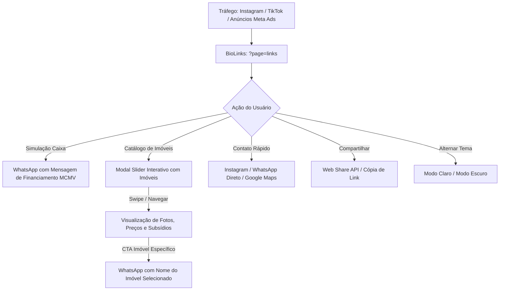

# PRD: BioLinks Imobiliário de Alta Conversão (Mobile Editorial)
> **Referência Técnica**: Replicador e Especificação Oficial de `http://localhost:3000/?page=links` (`<BioLinks />`)  
> **Versão**: 2.1.0  
> **Status**: Aprovado  
> **Público-Alvo**: Tráfego de Redes Sociais (Instagram, TikTok, WhatsApp, Meta Ads)

---

## 1. Visão Geral do Produto

### 1.1 Declaração do Problema
Tradicionais "link-in-bio" (como Linktree e soluções genéricas) apresentam limitações severas para corretores e imobiliárias de alto padrão:
- **Ausência de identidade de marca**: Não transmitem solidez corporativa nem credibilidade profissional.
- **Taxa de rejeição elevada**: Interfaces lentas, genéricas e sem apelo visual editorial.
- **Falta de catálogo integrado**: Forçam o usuário a sair da página ou a baixar PDFs pesados para ver opções de imóveis.
- **Conversão descontextualizada no WhatsApp**: O lead entra em contato sem contexto prévio de qual imóvel ou programa (ex: Minha Casa Minha Vida) chamou sua atenção.

### 1.2 Solução Proposta
Uma aplicação web **Mobile-First Editorial**, ultra-rápida, com visual refinado inspirado em revistas contemporâneas de arquitetura, reunindo:
1. **Identidade Visual de Forte Autoridade**: Fotografia profissional ampla com máscara e gradiente de fusão inferior suave, logotipo vetorial estilizado com telhado arquitetônico e selo oficial de corretor credenciado (CRECI).
2. **Dual-Theme Nativo (Light & Dark Mode)**: Alternância instantânea entre o modo claro corporativo (`#F4F6F9` / `#FFFFFF`) e o modo escuro nobre (*Royal Navy* `#060B14` / `#0A1220`).
3. **Hub Tátil de Ações Imediatas**: Grade compacta de canais prioritários (Instagram, WhatsApp oficial e Localização no Google Maps).
4. **Cards de Links de Alta Conversão**: Acessos diretos à simulação habitacional MCMV e parcerias com badges dinâmicos de destaque.
5. **Catálogo Interativo de Imóveis em Modal Slider**: Navegação em carrossel tátil com suporte a gestos touch swipe, atalhos de teclado, fotos em alta resolução, badges animados de subsídio MCMV e CTA direto para WhatsApp com mensagem pré-preenchida e contextualizada por empreendimento.
6. **Integração Nativa com Web Share API**: Compartilhamento instantâneo no celular com fallback para cópia na área de transferência.

---

## 2. Fluxo do Usuário & Casos de Uso



### 2.1 Personas Principais
- **Persona 1: Comprador do Primeiro Imóvel (Faixa MCMV - Grande Recife)**
  - Acessa via smartphone pelo link da bio do Instagram ou link de anúncio patrocinado.
  - Necessidade: Ver imóveis que cabem no bolso, checar subsídios e falar direto no WhatsApp sem burocracia.
- **Persona 2: Corretora de Imóveis (Danielle Galdino - CRECI-PE 21525)**
  - Necessidade: Um hub de links profissional para posicionar na bio das redes e criativos de tráfego pago, centralizando a captação de leads qualificados.
- **Persona 3: Parceiro Imobiliário / Correspondente Bancário (Aurora Imobiliária)**
  - Necessidade: Canal oficial de co-branding e indicação mútua.

---

## 3. Especificação Estrutural de UI/UX

O layout opera como uma **"Mobile App nativa dentro do navegador"**, ocupando `min-h-[100dvh]` com container centralizado de largura máxima de smartphone (`max-w-md`), cantos arredondados e sombras de profundidade.

### 3.1 Anatomia da Interface

| Seção | Elemento | Especificação Técnica & Comportamento |
|---|---|---|
| **Top Action Bar** | Barra Flutuante Superior | Fixa no topo com `z-30`. Contém: botão Voltar ao Início (`Home`), Alternador de Tema (`Sun`/`Moon`) e Compartilhar (`Share2`). |
| **Hero Editorial** | Foto Ampla da Corretora | Altura `h-[370px]` (mobile) a `h-[430px]` (desktop). Enquadramento superior (`object-[center_12%]`) com degradê suave de transição inferior (`h-44` a `h-52`). |
| **Identidade** | Logotipo & Branding | Offset negativo (`-mt-[276px] sm:-mt-[300px]`) que sobrepõe o conteúdo na base da imagem. Logotipo vetorial `LogoDanielle` com o ícone de telhado vazado e tipografia corporativa. |
| **Quick Action Row** | 3 Botões Compactos | Grade horizontal com 3 botões táteis (`w-11 h-11` a `w-14 h-14`): Instagram, WhatsApp (em verde vibrante `#25D366`) e Google Maps (Paulista - PE). |
| **Action Cards** | Lista de Links de Conversão | Cards estilizados com hover 3D, ícones em container arredondado, badge de categoria (`Mais Procurado`, `Catálogo`, `Parceria`), texto de ação e seta chevron animada. |
| **Footer** | Rodapé Institucional | Compacto, com direitos autorais, número oficial do CRECI (`CRECI-PE 21525`) e slogan oficial da marca. |
| **Modal Slider** | Catálogo Interativo | Janela modal `max-w-md` com backdrop blur escuro (`bg-black/80`), controle por toque swipe, setas flutuantes, indicadores tipo pílula e CTA contextual para WhatsApp. |

---

## 4. Detalhamento dos Componentes

### 4.1 Barra Superior Flutuante (Floating Action Bar)
- **Posicionamento**: `absolute top-4 inset-x-4 z-30 flex items-center justify-between pointer-events-auto`.
- **Ações**:
  1. **Home (`/`)**: Retorna ao site institucional ou página raiz com botão circular translúcido (`backdrop-blur-md`).
  2. **Alternador de Tema**: Altera o estado `theme` entre `'light'` e `'dark'`.
     - *Light Mode*: ícone da Lua (`<Moon size={16} />`), fundo branco translúcido, borda cinza suave.
     - *Dark Mode*: ícone do Sol dourado (`<Sun size={16} className="text-amber-300" />`), fundo escuro translúcido com borda suave.
  3. **Compartilhar Perfil**:
     - Dispara `navigator.share` com título da corretora, slogan e URL atual.
     - Fallback: Copia a URL para o clipboard (`navigator.clipboard.writeText`) com feedback visual.

### 4.2 Topo Editorial (Banner com Transição em Fade)
- Imagem: Fotografia oficial da corretora em alta resolução com `fetchPriority="high"` para otimizar LCP.
- Transição: Overlay com `bg-gradient-to-t` que funde a base da foto diretamente com o fundo do container:
  - *Light*: `bg-gradient-to-t from-white via-white/80 to-transparent`
  - *Dark*: `bg-gradient-to-t from-[#0A1220] via-[#0A1220]/80 to-transparent`

### 4.3 Logotipo e Identidade Vetorial (`LogoDanielle`)
- Renderização vetorial SVG com anti-aliasing responsivo.
- Telhado arquitetônico em linha laranja/dourada (`#F28C0F`) posicionado com precisão sobre o nome.
- Cores dinâmicas para alto contraste em fundos claros e escuros.

### 4.4 Linha de Contato Rápido (3 Botões)
1. **Instagram**: Link externo para `@corretoradaniellegaldino`.
2. **WhatsApp Oficial**: Link direto da API oficial do WhatsApp com mensagem de boas-vindas:
   ```text
   "Olá Danielle! Vim pelo seu perfil do Instagram e gostaria de conversar com você!"
   ```
3. **Localização**: Link direto para Google Maps com endereço cadastrado em Paulista - PE:
   ```text
   https://maps.google.com/?q=R.+Fazendinha,+72,+Paulista+-+PE
   ```

### 4.5 Lista de Cards de Ação (Primary Links)
1. **Simulação Caixa**:
   - Ícone: Vetor oficial do WhatsApp.
   - Badge: `Mais Procurado` (laranja).
   - Ação: Redireciona para WhatsApp com:
     ```text
     "Olá Danielle, vim pelo link da bio do Instagram e gostaria de simular meu financiamento Minha Casa Minha Vida!"
     ```
2. **Catálogo de Imóveis**:
   - Ícone: Edifício (`Building2`).
   - Badge: `Catálogo` (laranja).
   - Ação: Dispara `setIsCatalogModalOpen(true)` abrindo o modal interativo.
3. **Aurora Imobiliária**:
   - Ícone: Edifício (`Building2`).
   - Badge: `Parceria` (laranja).
   - Ação: Link externo para o Instagram oficial da imobiliária parceira.

---

## 5. Especificação do Catálogo Interativo Modal (Slider)

### 5.1 Requisitos Funcionais do Modal
1. **Abertura & Fechamento**:
   - Transição suave com `backdrop-blur-md` e animação `fadeIn`.
   - Fecha ao clicar no backdrop escuro.
   - Fecha ao clicar no botão `X` do cabeçalho.
   - Fecha ao pressionar a tecla `Escape`.
   - Bloqueio de scroll de fundo (`document.body.style.overflow = "hidden"`).
2. **Navegação do Carrossel**:
   - **Gesto Touch (Mobile)**: Detecção de distância mínima de 45px entre `onTouchStart` e `onTouchEnd`. Deslizar para a esquerda avança para o próximo imóvel; deslizar para a direita volta para o anterior em loop infinito.
   - **Teclado**: Teclas `ArrowLeft` e `ArrowRight` navegam entre os imóveis.
   - **Setas Flutuantes**: Botões circulares translúcidos sobre a imagem com ícones `<ChevronLeft />` e `<ChevronRight />`.
   - **Indicadores de Paginação**: Bolinhas dinâmicas no rodapé que expandem para formato de pílula (`w-6 h-2`) no imóvel selecionado.
3. **Conteúdo de Cada Imóvel**:
   - Imagem do imóvel com zoom suave no hover (`scale-105`).
   - Badges sobrepostos: Subtipo do imóvel e badge verde `MCMV` com ponto pulsante animado (`animate-pulse`).
   - Faixa inferior translúcida com Bairro, Metragem e Quartos (`X m² • Y Qts`).
   - Título, localização completa e lista de comodidades com ícones de check verde.
   - Bloco de condição financeira: Preço formatado e tag verde `Subsídio Disponível`.
4. **CTA Contextual para WhatsApp**:
   - Botão largo na cor verde oficial do WhatsApp (`#25D366`).
   - Mensagem dinâmica contextualizada:
     ```text
     "Olá Danielle! Gostaria de mais informações sobre o Residencial Toledo no Janga."
     ```
5. **Acesso ao Site Completo**:
   - Link de rodapé `/#properties` permitindo ao usuário abrir a listagem completa.

---

## 6. Design Tokens & Cores

| Token | Código HEX | Utilização |
|---|---|---|
| `--color-primary` | `#F28C0F` | Laranja de destaque, botões principais, badges de ênfase e bolinha ativa de paginação. |
| `--color-primary-hover` | `#DE7D09` | Estado hover de botões e links principais. |
| `--color-secondary` | `#101C30` | Azul marinho escuro corporativo para textos e elementos no Light Mode. |
| `--color-bg-dark` | `#0A1220` | Fundo principal do card no Dark Mode. |
| `--color-bg-darker` | `#060B14` | Fundo externo do viewport no Dark Mode. |
| `--color-bg-light` | `#F4F6F9` | Fundo externo do viewport no Light Mode. |
| `--color-bg-white` | `#FFFFFF` | Fundo do card principal e cartões no Light Mode. |
| `--color-whatsapp` | `#25D366` | Cor oficial do botão e ícones do WhatsApp. |
| `--color-mcmv-green` | `#6FC34B` | Verde institucional do Minha Casa Minha Vida e badges de aprovação. |
| `--color-border-subtle` | `#E2E8F0` / `rgba(255,255,255,0.1)` | Linhas divisórias e contornos de cards. |

---

## 7. Estrutura de Dados & Schema

```typescript
export interface BrandData {
  name: string;
  brokerName: string;
  creci: string;
  photo: string;
  photoAlt: string;
  slogan: string;
  partner: string;
  company: string;
  tagline: string;
  address: string;
  mapsUrl: string;
  instagram: string;
  instagramPartner: string;
  whatsappPhone: string;
  whatsapp: string;
}

export interface PropertyItem {
  id: string;
  name: string;
  location: string;
  neighborhood: string;
  city: string;
  priceFormatted: string;
  subType: "Apartamento" | "Casa Privê" | "Casa Solta";
  floorSizeMTK: number;
  numberOfBedrooms: number;
  image: string;
  amenities: string[];
  whatsappMessage: string;
}
```

---

## 8. Métricas de Conversão & Rastreamento (Analytics)

| Evento | Gatilho | Parâmetros Coletados |
|---|---|---|
| `biolinks_view` | Acesso à página | `utm_source`, `utm_medium`, `utm_campaign` |
| `click_whatsapp_simulacao` | Clique no card "Simulação Caixa" | Canal WhatsApp, mensagem |
| `open_catalog_modal` | Clique no card "Catálogo de Imóveis" | Timestamp |
| `swipe_catalog_slide` | Troca de imóvel no slider | `property_id`, `property_name`, `slide_index` |
| `click_whatsapp_property` | Clique no botão do WhatsApp no modal | `property_id`, `property_name`, `price` |
| `share_profile_click` | Clique no ícone de compartilhamento | Método (`native_share` ou `clipboard_copy`) |
| `toggle_theme_click` | Alternância de tema | `theme` (`light` ou `dark`) |

---

## 9. Requisitos Não-Funcionais
1. **Performance**: LCP < 1.0s através de pre-fetch da foto do banner; CLS = 0; FID/INP < 50ms.
2. **Viewport 100dvh**: Compatibilidade total com navegadores mobile com barras retráteis (Safari iOS / Chrome Android).
3. **Acessibilidade**: Contraste WCAG 2.1 AA (> 4.5:1), suporte a `aria-label`, foco visível e navegação por teclado.
4. **OpenGraph & Social Meta**: Meta tags com imagem de preview para compartilhamento no WhatsApp e Instagram.
